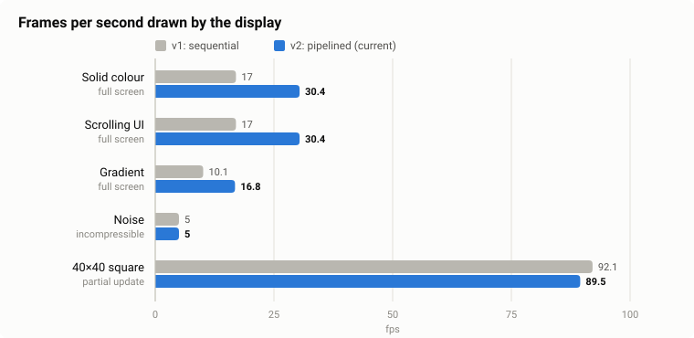
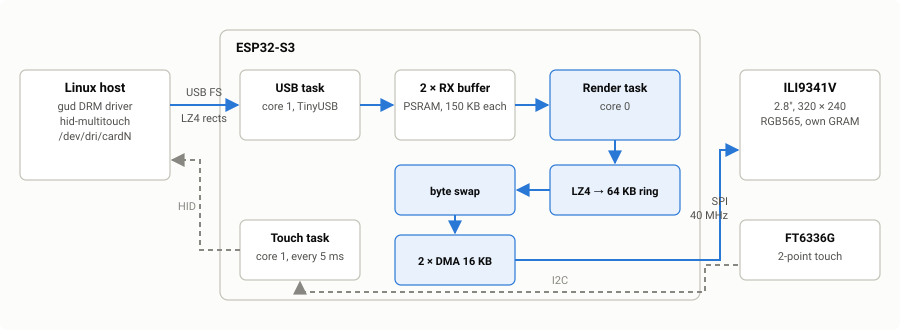

# gud-es3c28p

Turns the **LCDWiki ES3C28P** (2.8" ESP32-S3 board) into a plug-and-play USB touchscreen for Linux.
Plug it in, and the kernel sees a normal display (`gud` driver) and a normal touchscreen
(`hid-multitouch`). No custom host driver, no daemon.

Port of [Ponywka/gud-esp32s3](https://github.com/Ponywka/gud-esp32s3), which does the same for a
Waveshare 4.3" RGB board. Here the panel is an SPI ILI9341, so the whole drawing path is rewritten.

## Specs

| | |
|---|---|
| Board | LCDWiki ES3C28P, ESP32-S3-WROOM-1-N16R8 (16 MB flash, 8 MB PSRAM) |
| Panel | ILI9341V, 2.8", **320 × 240** landscape (portrait selectable), RGB565 |
| Touch | FT6336G capacitive, 2 points |
| USB | native Type-C, Full-Speed 12 Mbit/s, `1d50:614d` |
| Host sees | `/dev/dri/cardN` + `/dev/fbN` (gud), `/dev/input/eventN` (touch), `/sys/class/backlight/cardN-USB-1-backlight` |
| Compression | LZ4 on every update, only changed rectangles are sent |
| Panel link | SPI 40 MHz, DMA |
| Frame rate | **30 fps** full-screen UI, **17 fps** gradients, ~**90 fps** small updates |

## Performance



Measured with [`tools/gud_bench.c`](tools/gud_bench.c). The frame rate is counted on the board, because
the Linux driver silently merges frames the device can't keep up with.

| Test | fps | What limits it |
|---|---|---|
| Solid colour, full screen | 30.4 | SPI: 150 KB per frame at 40 MHz = 31 ms |
| Scrolling UI, full screen | 30.4 | SPI, same as above |
| Gradient, full screen | 16.8 | USB: compresses only 4×, 37 KB per frame |
| Noise (worst case) | 5.0 | USB: nothing to compress, ~750 KB/s |
| 40×40 moving square | 89.5 | USB round trip, ~6 ms per update |

The host was Ubuntu 20.04 (kernel 5.15) in VirtualBox, which adds latency to every USB transfer.
A real Linux machine should do better on small updates; the full-screen numbers are already at the
SPI or USB limit.

v1 was the first working version, where receiving, decoding and drawing ran one after another.
v2 runs them in parallel (see below).

## How it works



- The host sends only the rectangles that changed, LZ4-compressed, one USB transfer each.
- The **USB task** only receives. There are two receive buffers, so the next update comes in while
  the current one is being drawn. If both are busy, the board NAKs the host until one frees up.
- The **render task** decompresses into a 64 KB ring in internal RAM, swaps the bytes to the panel's
  order and feeds two 16 KB DMA buffers: one is on the SPI bus while the other is being filled.
- The picture is never kept on the ESP32; it goes straight into the panel's own memory.
- Touch is polled every 5 ms and sent as a standard HID multitouch report, already rotated to match
  the picture.

## Build and flash

You need ESP-IDF v6.1 (v5.3+ should work too).

```sh
idf.py set-target esp32s3
idf.py build
```

First flash: hold **BOOT**, press **RST**, release **BOOT**, then:

```sh
idf.py -p COMx flash
```

After that the Type-C port belongs to the display, so it no longer shows up as a serial port.
To flash again, either do BOOT + RST again, or from a Linux host run `tools/usb_flash.py`: it asks the
firmware to reboot and catches the 1.5 s download window the bootloader opens on every boot.

Logs go to UART0 (IO43 TX / IO44 RX) if you connect a USB-UART adapter.

## Use it on Linux

```sh
sudo modprobe gud
ls /sys/class/drm | grep USB        # card1-USB-1
```

Ubuntu 22.04+ and Armbian ship the `gud` module. Ubuntu 20.04 needs the HWE kernel
(`linux-generic-hwe-20.04`, 5.15). Debian disables it; build it from [`host/gud-module`](host/gud-module).

On first plug-in the screen shows `<NO SIGNAL>` and goes dark after 60 s if nothing is drawn.
DPMS and the brightness slider work; brightness is saved on the board.

### Quick tests

Stop the desktop first if it grabs the display (`sudo systemctl stop gdm3`), then:

```sh
sudo apt install gcc libdrm-dev evtest
gcc tools/gud_test.c -o gud_test $(pkg-config --cflags --libs libdrm)
gcc -O2 tools/gud_bench.c -o gud_bench $(pkg-config --cflags --libs libdrm)

sudo ./gud_test             # colour bars, then a moving square
sudo ./gud_bench            # the benchmark above, 8 s per test
sudo evtest                 # pick "ES3C28P GUD Touch Display", touch the corners

# play a video
ffmpeg -i clip.mp4 -vf scale=320:240 -pix_fmt bgr0 -f rawvideo - 2>/dev/null | sudo ./gud_bench video
```

The colour bars should read white, red, green, blue, yellow, magenta, cyan, black from left to right.

## Configuration

Everything is in [`main/board.h`](main/board.h).

| Setting | Default | |
|---|---|---|
| `BOARD_LCD_ROTATION` | `1` | 0 portrait, 1 landscape, 2 and 3 upside down. Touch follows. |
| `BOARD_LCD_SPI_HZ` | 40 MHz | 80 MHz garbles this panel; try it on yours with `-DBOARD_LCD_SPI_HZ=80000000` |
| `BOARD_LCD_INVERT` | `1` | this panel needs inversion; set 0 if the picture looks like a negative |
| `BOARD_LCD_BGR` | `1` | flip if red and blue are swapped |
| `BOARD_BL_DEFAULT_PERCENT` | `50` | brightness before anything was saved |

Rotation and SPI clock can also be set at build time: `idf.py -DBOARD_LCD_ROTATION=0 build`.

## Pins

| Function | GPIO |
|---|---|
| LCD CS / DC / SCK / MOSI / MISO | 10 / 46 / 12 / 11 / 13 (RST is tied to EN) |
| Backlight | 45 |
| Touch SDA / SCL / RST / INT | 16 / 15 / 18 / 17 |
| USB D- / D+ | 19 / 20 |

## Troubleshooting

- **Picture garbled or shifted:** the SPI clock is too high for your panel. Stay at 40 MHz.
- **Colours look like a negative:** flip `BOARD_LCD_INVERT`.
- **`modetest -M gud` says "no device found":** old libdrm. Use `tools/gud_test.c` instead.
- **`drmModeSetCrtc: Permission denied`:** the desktop owns the display. Stop it, or add the display
  as a second monitor in your desktop settings.
- **Writing to `/dev/fbN` shows nothing:** nothing has switched the display on since boot. Use a DRM
  client such as `gud_test` or a desktop session.

## Project layout

```
main/                    firmware: board, lcd (ILI9341), touch (FT6336G), usb_glue, screen/ui
main/gud/                GUD protocol, USB class driver + render task, LZ4 decoder
components/tinyusb/      TinyUSB 0.21 (device, HID, DWC2 only)
bootloader_components/   USB download window on every boot
tools/                   gud_test, gud_bench, usb_flash.py, host tests (tools/test)
host/gud-module/         the Linux gud driver, for kernels that don't ship it
docs/images/             the figures in this file
```

The LZ4 decoder and the byte swap have host tests that compile the firmware sources directly:
`pip install lz4 ziglang && python tools/test/test_lz4.py` (104 cases).

## License

MIT, see [LICENSE](LICENSE). TinyUSB, the GUD protocol code from gud-pico and the Linux `gud` driver
keep their own licenses, see [THIRD_PARTY.md](THIRD_PARTY.md).
